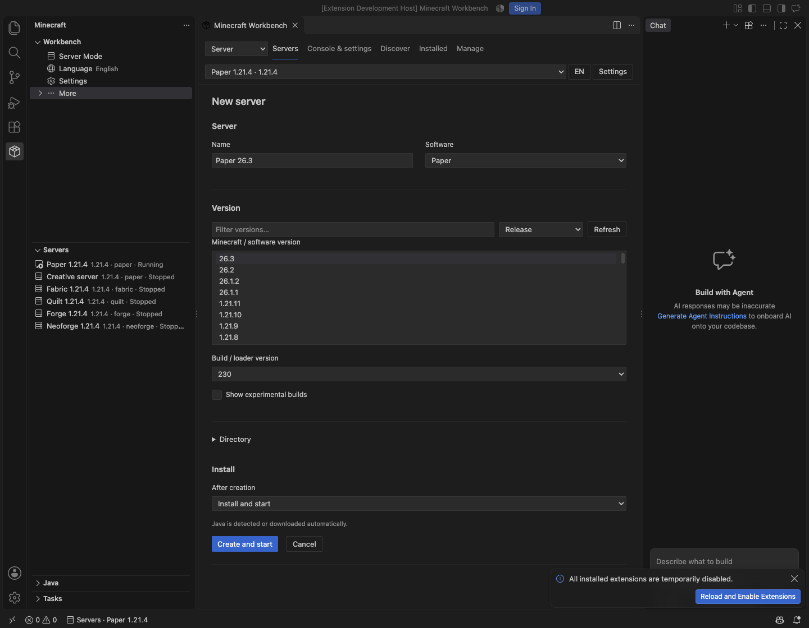
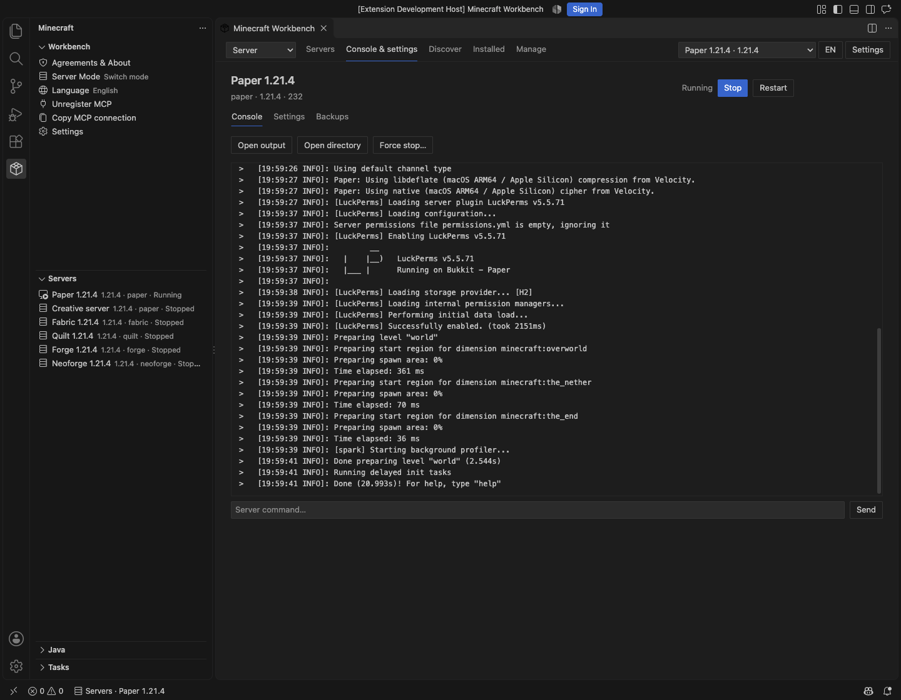

# Minecraft Workbench

[下载](https://github.com/lopleec/VSCode-minecraft-workbench/releases/latest) · [English](README.md) · [双语 README](README.md)

## 简体中文

在 VS Code 中启动 Minecraft Java 版、管理实例并开发模组。使用原生侧栏、命令、设置、任务和输出窗口；编辑器页面适配深色、浅色与高对比主题。默认跟随 VS Code 语言，也可单独手动选择英文或简体中文。

### 安装与开始使用

需要桌面版 **VS Code 1.96+**，仅支持 **Minecraft Java 版**。游戏所需 Java 可在插件中检测、手动添加或下载；开发模组需要 JDK。首次下载需要网络，完整安装后可使用离线账户启动，无需重新获取版本清单。

1. 打开 [最新 Release](https://github.com/lopleec/VSCode-minecraft-workbench/releases/latest)。
2. 在 **Assets** 中下载 `minecraft-workbench-<版本号>.vsix`。
3. 在 VS Code 中执行 **扩展：从 VSIX 安装…**，选择下载的文件。
4. 按提示重新加载 VS Code，然后打开活动栏中的 **Minecraft**。

下载和启动进程需要受信任的工作区。开发构建可从成功的 [CI 运行](https://github.com/lopleec/VSCode-minecraft-workbench/actions/workflows/ci.yml) 中下载 **Artifacts → minecraft-workbench-vsix**，解压后安装其中的 VSIX。

安装 VSIX 不需要额外安装 Node.js，扩展使用 VS Code 自带的运行时。从源码构建、打包需要 **Node.js 22+**，这是打包工具链的要求：

```sh
git clone https://github.com/lopleec/VSCode-minecraft-workbench.git
cd VSCode-minecraft-workbench
npm ci
npm run package
```

生成的 `.vsix` 按上面的步骤安装。

Publisher 为 `Lopleec`，扩展 ID 为 `Lopleec.minecraft-workbench`。从旧的 `minecraft-workbench.minecraft-workbench` 开发包升级时，请先卸载旧包。扩展会检测并复用原有默认存储；Microsoft 账户需要重新登录，因为 SecretStorage 按扩展 ID 隔离。
SSH、WSL、容器中的文件和进程位于扩展宿主机器；在远程机器运行游戏需要图形环境。

### 插件更新

GitHub / 手动 VSIX 安装可使用**更多 → 检查插件更新**。点击后才联网检查；有新的稳定版本时，可打开下载链接、更新说明，或在本地桌面窗口选择**下载并安装**。安装前校验发布的 SHA-256、扩展标识、版本与 VS Code 要求。重新加载仍需另行点击，游戏或服务端运行时不会执行。

关闭 `minecraftWorkbench.updates.enabled` 可隐藏入口并禁用、取消检查。没有启动检查、定时检查或静默安装。Marketplace 安装继续由 VS Code 管理更新。VS Code 没有公开的安装来源 API，因此通过本地安装记录识别；来源不明或远程窗口提供手动下载链接。VSIX 记录只能识别手动安装，不能证明下载网站。

### 首次使用与协议

首次打开会显示 **协议与关于**。阅读链接中的 [Minecraft EULA](https://www.minecraft.net/en-us/eula) 与插件的 [用户协议和声明](TERMS.md)，勾选两项后选择 **同意并继续**。两项默认均未勾选；选择 **暂不使用** 会关闭页面，插件操作保持不可用。

未同意时仅开放协议阅读、语言选择、确认与关闭，其余插件命令和操作均锁定；侧栏“语言”仍可修改插件整体的语言。

协议页默认跟随插件语言；手动选择只改变协议页，不修改插件、侧栏或 VS Code 的语言设置。插件整体默认跟随 VS Code。


仅将提示版本、确认时间和两项选择保存在本地 VS Code 配置中。插件提示更新后需重新确认；此版本号不代表 Mojang EULA 版本。之后可通过侧栏或命令面板的 **协议与关于** 再次查看。此确认不为 MIT 增加限制，也不授予 Minecraft 游戏许可。

### 启动模式

1. 打开 **实例 → 新建实例**，填写名称，选择游戏版本、加载器和父目录。
2. 在 **管理 → 账户** 添加离线账户，或按下文配置 Microsoft 登录。
3. 在 **管理 → Java** 检测、添加 Java 或下载 Eclipse Temurin JDK。
4. 选择 **安装 / 修复**，完成后启动。也可先保存实例，稍后安装。

版本列表包含 Mojang 清单中的正式版、快照与预发布版、愚人节版本、旧 Beta 和旧 Alpha。支持对应游戏版本可用的 Vanilla、Fabric、Quilt、Forge、NeoForge，以及 Loader 测试版本。创建后可以更改游戏版本、更新或重装 Loader，失败后可修复重试。

| 功能 | 支持内容 |
| --- | --- |
| 实例 | 独立游戏目录、版本切换、修复、复制（可选存档）、移动目录、上次启动与游戏时长 |
| 启动 | 独立账户与 Java、内存、GC、JVM / 游戏参数、窗口尺寸、全屏、自动加入服务器 |
| 内容 | Modrinth 模组、整合包、资源包、光影；导入本地 JAR/ZIP；启用、禁用、删除、更新 |
| 存档 | 完整 `saves` 备份与恢复、可选启动前备份、保留数量 |
| 下载 | 进度、取消、重试、断点续传、哈希校验、镜像与代理 |
| 账户与 Java | 多离线 / Microsoft 账户切换、本地 Java 检测、Temurin 下载 |

### 内容浏览与依赖

从 **内容 → 浏览内容** 打开页面。发现页默认按下载量展示项目图标、简介和下载数，也可搜索或按相关度、关注数、更新与发布时间排序。选择实例后，可按游戏版本和 Loader 筛选兼容内容。

**版本** 支持游戏版本、Loader 和发布类型筛选；**查看全部版本** 会显示不兼容版本，但不能将它们安装进当前实例。选定版本后先查看依赖计划，再安装。必需前置递归解析，可选依赖可单独勾选。

Fabric / Quilt 会读取 `fabric.mod.json`、内嵌模块、版本范围和声明的不兼容项；Forge / NeoForge 使用 Modrinth 声明及游戏、Loader 兼容性信息。冲突检查可发现声明的依赖问题、重复 Fabric ID、损坏文件，不能预测所有运行时或 Mixin 冲突。

**已安装** 页面支持筛选、导入本地文件、启用、禁用、删除和更新。更新保留禁用状态，旧文件存放在 `.workbench/history`。光影包需配合 Iris、Oculus 等兼容模组。

可从 **实例 → 导入整合包** 或 **已安装 → 导入整合包…** 导入本地 `.mrpack`，也可从 Modrinth 安装，新建实例并应用公共及客户端覆盖文件，跳过仅服务端和客户端可选文件。导出包含已启用内容与配置：已识别文件使用下载引用，本地文件作为覆盖文件。排除存档、日志、服务器列表和账户元数据。**暂不支持 CurseForge 整合包。**

### 内存、语言与实例设置

内存在**创建后的实例设置**或全局设置中调整。默认最小、最大内存为 `0`（自动）：最大值取**系统内存的 25%**，向下取整到 128 MB，上限 8 GiB；最小值随之调整，通常为 256–1024 MB。可修改全局百分比，或取消 **使用全局内存设置**，为实例单独填写。手动值优先。


通过侧栏 **语言**、命令面板 **切换语言** 或 **EN / 中** 按钮即时切换。语言可独立于 VS Code 设置。

修改内容、版本或恢复存档前需停止实例。恢复前自动备份当前存档。删除实例会将整个游戏目录移至系统废纸篓（系统支持时）。

### 账户与 Microsoft 登录

**插件不内置 Microsoft Client ID**；留空时使用离线账户。离线身份无法通过要求 Microsoft / Minecraft 验证的服务器认证。

正版登录需在 **管理 → 账户** 或 `minecraftWorkbench.microsoftClientId` 中填写自己的公共客户端应用 ID。应用必须支持设备代码流程、个人 Microsoft 账户、Xbox 登录并获得 Minecraft Services 访问许可；仅创建应用 ID 不保证获得 Minecraft Services 许可。不需要也不会收集客户端密钥。

通过 Microsoft 设备登录页面授权。刷新令牌和 Minecraft 访问令牌存于 **VS Code SecretStorage**，到期前及启动前自动刷新；刷新失败需重新登录。移除账户会删除保存的凭据，账户名和 UUID 作为本地元数据保存。插件不收集遥测。

### 开服模式

在模式选择器中选择 **开服**，然后打开 **服务端 → 新建服务端**。选择服务端类型、Minecraft / 软件版本和构建版本。**创建并启动** 会下载服务端、检测或下载所需 JDK，然后启动；也可选择仅安装或仅创建。首次启动游戏服务端时需要确认 Minecraft EULA。



支持 **Vanilla、Paper、Purpur、Folia、Fabric、Quilt、Forge、NeoForge、Velocity**。**自定义 JAR** 可创建独立目录并导入可执行服务端 JAR。版本以各项目发布列表为准，并非每个历史 Minecraft 版本都提供独立服务端；实验构建需明确选择。

**控制台与设置** 包含输出、指令、正常停止和重启、Java 与内存、服务端属性、版本更换、修复和存档备份。编辑内容或恢复存档前需要停服。正常停服会发送保存与关闭指令；强制停止需确认。从列表移除服务端时会保留文件。



**发现** 与 **已安装** 使用当前服务端的兼容条件。Paper / Purpur 可安装兼容的 Bukkit、Spigot、Paper 插件；Folia 仅接受明确声明支持 Folia 的版本；Velocity 筛选其对应插件。Fabric、Quilt、Forge、NeoForge 使用服务端模组。版本、简介、图标、前置预览、更新、启用、禁用和删除与客户端使用同一套页面；拒绝仅客户端项目，也可导入本地 JAR。自定义 JAR 不会自动推断插件或模组平台。

新游戏服务端默认绑定 `127.0.0.1`。局域网访问可在 **设置 → 网络 → 绑定地址** 中改为 `0.0.0.0`。防火墙、路由器端口转发和公网托管需另行配置。Velocity 属于代理端，可通过 **打开配置文件** 编辑 `velocity.toml`，设置后端服务端。

### AI 与 MCP

MCP **默认关闭**。点击 **工作台 → 设置 → 注册 MCP**，或启用 `minecraftWorkbench.mcp.enabled`，VS Code 1.101 及以上可在 MCP 提供程序和聊天工具选择器中启用 Minecraft Workbench；1.96–1.100 使用 **设置 → 复制 MCP 连接** 配置支持 MCP 的客户端，工具和访问控制保持一致。**取消注册 MCP** 会移除服务定义并关闭监听。

工具覆盖实例创建与启动、游戏及 Loader 版本、Modrinth 内容与前置、账户、Java、任务、备份、Gradle 项目、服务端管理和扩展设置。`workbench_state` 可获取当前列表。需要文件选择或确认的操作仍使用 VS Code 原生界面。AI 工具不能代替用户同意首次使用协议；服务端 EULA 也需要交互确认。

其他 MCP 客户端可使用 **复制 MCP 连接**，按客户端格式填入复制的 Streamable HTTP 配置。配置包含本地 URL 与授权请求头，仅在当前扩展宿主会话中有效；请勿公开请求头。接口只监听 `127.0.0.1` 并检查授权。远程工作区中，接口运行在扩展宿主机器。工具结果可能包含本地路径、项目信息和控制台日志，并适用所连接 AI 客户端的数据政策；工具不会返回登录令牌。

### 开发模式

在侧栏或状态栏切换模式，打开 **管理 → 项目**。

1. 选择 **Fabric / Forge / NeoForge** 和官方模板或 MDK 版本。
2. 填写模组名称、ID、Java 包名和目录。包名建议使用通用的 `com.example.<mod_id>`，可自行修改。
3. 创建后自动打开项目，也可关闭该选项；支持导入包含 Gradle wrapper 的已有项目。
4. 项目操作支持构建、清理、启动客户端、生成源码 / IDE 文件和查看构建产物。
5. 调试时先选择 **启动客户端并等待调试**，待 Gradle 监听端口后 **附加调试器**。按提示安装 **Debugger for Java**，默认端口 5005。

Gradle 通过项目 wrapper 在 VS Code Tasks 中运行，首次会下载 Gradle 与依赖。模板提供对应的游戏、Loader 和 Gradle 版本，部分历史版本没有维护中的模板。生成的是模组项目，并非反编译后的独立游戏客户端。插件代理用于插件管理的下载；Gradle 的仓库与代理遵循项目及 Gradle 配置。

### 网络、目录与诊断

工作台保留模式、语言和设置；**更多** 默认收起，包含 Java、任务、日志和协议。展开 **设置** 可管理代理凭据、MCP、存储目录或查看文档；点击设置文字仍打开原生设置页。MCP 默认关闭。分类保留 VS Code 原生分栏、分隔线和滚动；在 **工作台 → … → 显示侧栏分类** 中可直接找回被隐藏或移到下方的分类。

全局选项位于 **Minecraft Workbench：设置** 的原生分组中。

```json
{
  "minecraftWorkbench.language": "zh-cn",
  "minecraftWorkbench.minMemory": 0,
  "minecraftWorkbench.maxMemory": 0,
  "minecraftWorkbench.memoryPercentage": 25,
  "minecraftWorkbench.sources": {
    "manifest": "official",
    "assets": "bmclapi",
    "libraries": "bmclapi"
  }
}
```

- **下载源：** 可按 `manifest`、`client`、`server`、`assets`、`libraries`、`loader`、`modrinth`、`java`、`project` 设置 `official`、`bmclapi` 或 HTTPS 基地址。自定义地址保留原路径和查询参数；BMCLAPI 仅用于支持的端点。镜像失败回退原始地址，认证始终走官方端点。
- **代理：** 支持 HTTP、HTTPS、SOCKS5、SOCKS5h；SOCKS5 本地解析域名，SOCKS5h 由代理解析。留空时沿用 VS Code `http.proxy`。使用 **工作台 → 设置 → 代理凭据** 将凭据存入 SecretStorage。修改网络、存储配置后需重载窗口。
- **断点与校验：** 保留 `.part`，在服务器支持时使用 HTTP Range 和校验器续传；服务器忽略范围则重新下载。校验 Minecraft / Modrinth 公布的哈希及 JDK SHA-256。
- **目录：** 存储、游戏、服务端和项目目录可配置。新实例采用 Prism/MultiMC 格式；`.workbench` 只保存辅助索引、历史和备份。旧实例保留原有 `.runtime`。
- **日志：** 使用 **显示输出** 或 **打开游戏日志**。插件输出会隐藏认证令牌和代理凭据；分享外部游戏或模组日志前仍需检查内容。

### 下载复用与并发

带校验和的文件在实例间使用共享缓存，包括客户端、库、资源、服务端、JDK 和 Modrinth 文件。旧实例中的文件也会在校验后纳入缓存；相同版本只补缺失或不同的资源，实例文件保持独立副本。

至少 16 MiB 的文件默认使用 4 个 HTTP Range 连接、每段 8 MiB；全局并发上限默认为 6。重试保留已完成分段，不支持分段的源自动回退单连接。可配置 `sharedDownloadCache`、`downloadConnectionsPerFile`、`downloadChunkSize`、`downloadConcurrency`。设置作用于插件管理的下载；Gradle、服务端引导程序和安装器可能另行下载其依赖。

### 开发与验证

```sh
npm ci
npm test
npm run format:check
npm run legal -- --check
npm run compile
npm run test:host
npm run test:compat
npm run package
```

按 **F5** 打开扩展开发宿主。单元测试覆盖路径安全、状态保存及失败恢复、账户、续传、哈希、依赖、备份和项目定制。CI 在 Linux、Windows 和 macOS 检查格式、测试、编译和打包。

宿主测试需要网络与本地或可下载的 VS Code。`VSCODE_EXECUTABLE` 可指定本地程序，`MW_LIVE_INSTALL=1` 会额外下载安装 Fabric 测试实例。Microsoft 登录需要获批应用和账户，不自动测试。游戏启动和 Gradle 构建，以及 Paper、Fabric、Quilt、Forge、NeoForge 1.21.4 服务端的安装、启动和停服，已在 macOS Apple Silicon 验证；其他平台及所有历史游戏 / Loader 组合尚未逐一人工验证。

`npm run test:compat` 会在隔离配置中使用最低支持的 VS Code，检查激活、协议保护、模式切换和 MCP。

截图来自 VS Code 中运行的插件，使用示例实例和实时 Modrinth 元数据。项目图标、简介属于各自作者。

### 反馈与贡献

欢迎提交问题、功能建议、翻译改进和 Pull Request。

- **问题反馈：** 请先搜索[已有 Issue](https://github.com/lopleec/VSCode-minecraft-workbench/issues)，再[创建 Issue](https://github.com/lopleec/VSCode-minecraft-workbench/issues/new)。提供复现步骤、预期与实际表现、插件及 VS Code 版本、系统与架构。游戏相关问题请附上 Minecraft、Loader、Java 版本、相关模组和简短日志。
- **功能建议：** 在 [Issue](https://github.com/lopleec/VSCode-minecraft-workbench/issues/new) 中说明使用场景和希望改善的操作流程。界面建议可附截图或小示例。
- **提交 PR：** Fork 仓库并创建分支，每个 PR 聚焦一项改动，说明问题、修改内容和验证方式。较大改动建议先通过 Issue 讨论。遵循现有代码风格，修改界面文案或文档时同步更新中英文，界面改动附上截图。提交 [Pull Request](https://github.com/lopleec/VSCode-minecraft-workbench/pulls) 前运行上文列出的相关检查。

分享日志和截图前，请移除令牌、代理凭据、账户信息和个人路径。源码贡献中不要包含下载的游戏文件、存档、本地实例数据或生成的 VSIX。贡献采用项目的 [MIT License](LICENSE)，第三方内容保留各自许可。

### 许可与致谢

[MIT License](LICENSE)，Copyright © 2026 Lopleec。依赖许可见 [THIRD_PARTY_NOTICES.md](THIRD_PARTY_NOTICES.md) 和 [THIRD_PARTY_LICENSES.txt](THIRD_PARTY_LICENSES.txt)。

使用 VS Code API、XMCL、Modrinth API，以及 Fabric、Forge、NeoForge 官方模板。本项目独立于 Mojang、Microsoft、Modrinth 和各 Loader 项目。游戏文件、账户与下载内容仍适用各自条款和许可。

### 界面示例


## 现有实例与存储

新建实例统一使用 **Prism / MultiMC 格式**：以实例名称建立目录，其中包含 `instance.cfg`、`mmc-pack.json` 和 `.minecraft` 游戏目录。世界存档仍是 `saves/世界名称/` 下的原生 Java 版存档。版本文件、运行库和资源使用系统 Minecraft 目录，也可通过 `minecraftWorkbench.gameDirectory` 更改。`minecraftWorkbench.instanceDirectory` 可单独指定实例父目录，包括现有的 PrismLauncher `instances` 目录。旧版工作台实例继续兼容。

在 **实例 → 导入实例** 中扫描 Minecraft/HMCL/PCL 目录、Prism/MultiMC 实例目录、Modrinth 档案目录或 ZIP 导出文件，预览会显示识别出的 Minecraft 和 Loader 版本。**原地管理**保留原目录，与原启动器共用文件，移除登记时保留游戏文件；**复制导入**创建独立的 Prism/MultiMC 实例，保留模组、配置和世界存档。不会导入原启动器的执行钩子或账户数据库。缺失的运行资源在首次启动时补齐。

**导出实例**生成 Prism/MultiMC ZIP，可选包含世界存档；**导入整合包 / 导出 .mrpack** 使用 [Modrinth 格式](https://support.modrinth.com/en/articles/8802351-modrinth-modpack-format-mrpack)。新版 Modrinth App 若未保留 `profile.json`，请先导出 `.mrpack`。旧式 Jar 模组、无法识别的 MultiMC 组件会明确提示，不会静默忽略。启动器专有补丁需要复制导入并重建受支持的 Loader。ZIP 超过 512 MB 时，请先解压或直接复制实例目录。

**存档备份 → 导入 / 导出世界存档**支持原生 Java 版世界目录和 ZIP，可使用其他启动器中的存档。同名世界另建编号副本。基岩版 `.mcworld` 需先转换格式。

游戏语言首次跟随扩展，扩展默认跟随 VS Code。自动模式保留玩家在游戏中选择的语言；可在实例设置或 `minecraftWorkbench.gameLanguage` 中覆盖，取值为 `auto`、`preserve` 或 `en_us`、`zh_cn` 等 Minecraft 语言代码。

**账户 → 外置登录**支持 authlib-injector。填写 HTTPS Yggdrasil API 地址，例如 LittleSkin 的 `https://littleskin.cn/api/yggdrasil`，在 VS Code 中输入凭据并选择角色。支持 ALI 地址识别；令牌保存在 SecretStorage，不保存密码。启动前校验、刷新令牌，需要时下载并进行 SHA-256 校验的 authlib-injector。外置账户只能用于配置了对应认证服务的服务器。

输入凭据前，需在原生风险提示中核对识别后的完整认证 API 地址并确认。用户名、密码会发送给服务商，由其签发令牌；请使用独立密码，切勿填写 Microsoft 密码。HTTPS 不代表服务商可信。移除账户只删除本地凭据，如需撤销访问，请前往服务商处理。界面不预选服务商。[第三方服务与许可](THIRD_PARTY_NOTICES.md)列明服务条款、隐私链接及单独下载组件的许可。

### 陶瓦联机（Beta）

此可选功能**默认关闭**。在设置中开启 `minecraftWorkbench.terracotta.enabled` 后，从 **更多 → 陶瓦联机（Beta）** 进入。下载和运行组件前需阅读上游许可及联机须知，分别勾选确认；须知语言可以单独切换，不更改扩展语言。

1. 下载官方组件，或选择已有的官方可执行文件。下载固定支持版本并校验官方 SHA-256；macOS 需先打开官方安装包，配置其后台组件，再连接。
2. 连接组件。房主将 Minecraft 世界开放到局域网后点击**创建房间**；访客填写陶瓦房间码并**加入房间**。
3. 访客可复制游戏地址，或直接启动所选实例进入房间；临时地址不会覆盖实例原有的服务器设置。
4. 结束后退出房间。关闭设置或撤回确认会断开本扩展创建的连接。可通过 `minecraftWorkbench.terracotta.publicNodes` 指定额外公共节点。

[Terracotta / 陶瓦联机](https://github.com/burningtnt/Terracotta) 是 Burning_TNT 及贡献者的独立项目，采用附带上游例外的 AGPL-3.0-or-later。插件通过本地 HTTP 接口调用未修改的官方程序，不将它打包进扩展。当前 Beta 面向陶瓦 0.4 接口及 Java 版局域网世界；穿透和中继可用性取决于各方网络与外部服务。请仅向希望加入的玩家分享房间码。


Java 优先级为：实例单独设置 → 全局默认 → 自动检测 / 下载。实例设置可留空；更改其他字段不会清除已有的 Java 配置。
