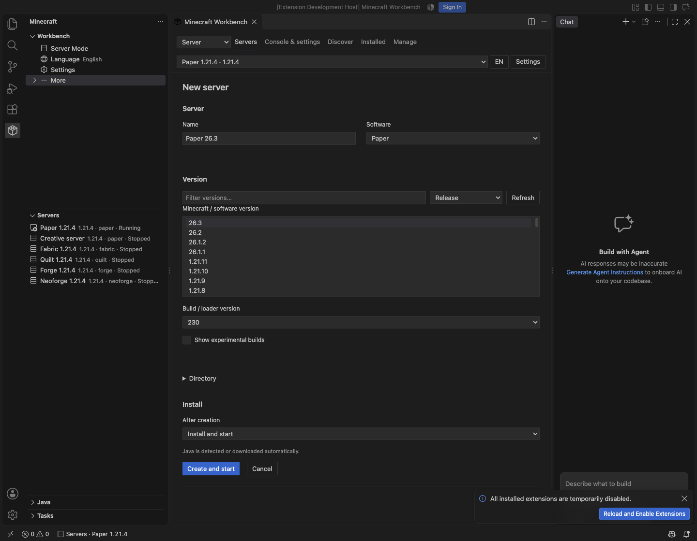
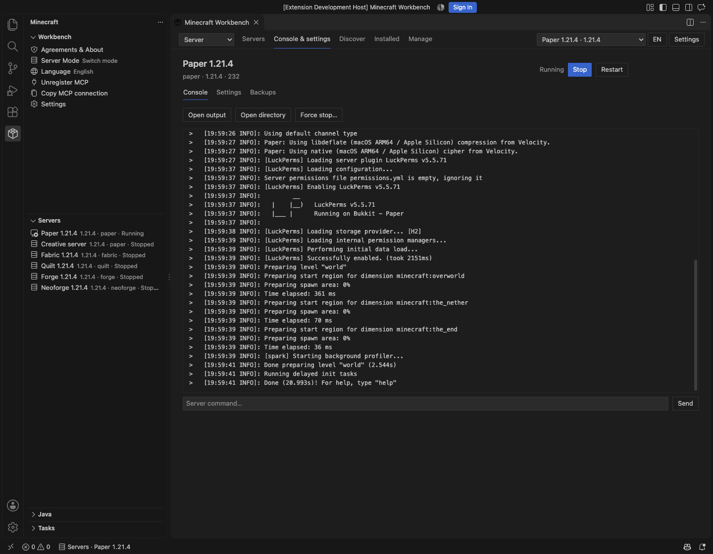

# Minecraft Workbench

[下載](https://github.com/lopleec/VSCode-minecraft-workbench/releases/latest) · [English](README.md) · [简体中文](README.zh-CN.md)

## 繁體中文

**Java 設定**、**工作**、**輸出**分別放在 **更多**。模組專案只出現在開發模式，各模式使用對應的管理頁面。可透過 `minecraftWorkbench.showRuntimeViews` 單獨顯示 Java 和工作分欄。擴充套件設定頁跟隨擴充套件語言，也保留 VS Code 原生設定入口。

在 VS Code 中啟動 Minecraft Java 版、管理實例並開發模組。使用原生側邊欄、命令、設定、工作和輸出視窗；編輯器頁面適配深色、淺色與高對比主題。預設跟隨 VS Code 語言，也可單獨手動選擇英文、簡體中文或繁體中文。

### 安裝與開始使用

需要桌面版 **VS Code 1.96+**，僅支援 **Minecraft Java 版**。遊戲所需 Java 可在擴充套件中偵測、手動新增或下載；開發模組需要 JDK。首次下載需要網路，完整安裝後可使用離線帳戶啟動，無需重新獲取版本清單。

1. 開啟 [最新 Release](https://github.com/lopleec/VSCode-minecraft-workbench/releases/latest)。
2. 在 **Assets** 中下載 `minecraft-workbench-<版本號碼>.vsix`。
3. 在 VS Code 中執行 **擴充套件：從 VSIX 安裝…**，選擇下載的檔案。
4. 按提示重新載入 VS Code，然後開啟活動欄中的 **Minecraft**。

下載和啟動處理程序需要受信任的工作區。開發建置可從成功的 [CI 執行](https://github.com/lopleec/VSCode-minecraft-workbench/actions/workflows/ci.yml) 中下載 **Artifacts → minecraft-workbench-vsix**，解壓後安裝其中的 VSIX。

安裝 VSIX 不需要額外安裝 Node.js，擴充套件使用 VS Code 自帶的執行階段。從原始碼建置、打包需要 **Node.js 22+**，這是打包工具鏈的要求：

```sh
git clone https://github.com/lopleec/VSCode-minecraft-workbench.git
cd VSCode-minecraft-workbench
npm ci
npm run package
```

生成的 `.vsix` 按上面的步驟安裝。

Publisher 為 `Lopleec`，擴充套件 ID 為 `Lopleec.minecraft-workbench`。從舊的 `minecraft-workbench.minecraft-workbench` 開發包升級時，請先卸載舊包。擴充套件會偵測並重複使用原有預設儲存；Microsoft 帳戶需要重新登入，因為 SecretStorage 按擴充套件 ID 隔離。
SSH、WSL、容器中的檔案和處理程序位於擴充套件宿主機器；在遠端機器執行遊戲需要圖形環境。

### 擴充套件更新

GitHub / 手動 VSIX 安裝可使用**更多 → 檢查擴充套件更新**。點選後才聯網檢查；有新的穩定版本時，可開啟下載連結、更新說明，或在本機桌面視窗選擇**下載並安裝**。安裝前驗證發行的 SHA-256、擴充套件識別碼、版本與 VS Code 要求。重新載入仍需另行點選，遊戲或伺服器執行階段不會執行。

關閉 `minecraftWorkbench.updates.enabled` 可隱藏入口並停用、取消檢查。沒有啟動檢查、定時檢查或靜默安裝。Marketplace 安裝繼續由 VS Code 管理更新。VS Code 沒有公開的安裝來源 API，因此透過本機安裝記錄識別；來源不明或遠端視窗提供手動下載連結。VSIX 記錄只能識別手動安裝，不能證明下載網站。

### 首次使用與協議

首次開啟會顯示 **協議與關於**。閱讀連結中的 [Minecraft EULA](https://www.minecraft.net/en-us/eula) 與擴充套件的 [使用者協議和聲明](TERMS.md)，勾選兩項後選擇 **同意並繼續**。兩項預設均未勾選；選擇 **暫不使用** 會關閉頁面，擴充套件操作保持不可用。

未同意時僅開放協議閱讀、語言選擇、確認與關閉，其余擴充套件命令和操作均鎖定；側邊欄“語言”仍可修改擴充套件整體的語言。

協議頁預設跟隨擴充套件語言；手動選擇只改變協議頁，不修改擴充套件、側邊欄或 VS Code 的語言設定。擴充套件整體預設跟隨 VS Code。


僅將提示版本、確認時間和兩項選擇儲存在本機 VS Code 設定中。擴充套件提示更新後需重新確認；此版本號碼不代表 Mojang EULA 版本。之後可透過側邊欄或命令面板的 **協議與關於** 再次查看。此確認不為 MIT 增加限制，也不授予 Minecraft 遊戲授權。

### 啟動模式

在 **實例 → 批量管理** 中可將所選實例移至分組，或批量停止、修復、刪除；預設關閉多選。分組同時顯示在原生側邊欄和實例清單中，可折疊、搜尋、按分組篩選及排序。選中分組篩選後可重命名或取消分組，遊戲檔案仍保留在原目錄。**匯入實例** 支援全選、選擇篩選結果、取消選擇及指定分組；整批匯入可以取消，保留已完成的實例，單項失敗不會中斷其他匯入。

1. 開啟 **實例 → 新增實例**，填寫名稱，選擇遊戲版本、載入器和上層目錄。
2. 在 **工具 → 帳戶** 新增離線帳戶，或按下文設定 Microsoft 登入。
3. 在 **更多 → Java 設定** 或 **工具 → Java** 偵測、新增 Java 或下載 Eclipse Temurin JDK。
4. 選擇 **安裝 / 修復**，完成後啟動。也可先儲存實例，稍後安裝。

版本清單包含 Mojang 清單中的正式版、快照與預發行版、愚人節版本、舊 Beta 和舊 Alpha。支援對應遊戲版本可用的 Vanilla、Fabric、Quilt、Forge、NeoForge，以及 Loader 測試版本。建立後可以更改遊戲版本、更新或重裝 Loader，失敗後可修復重試。

| 功能 | 支援內容 |
| --- | --- |
| 實例 | 獨立遊戲目錄、版本切換、修復、複製（選用存檔）、移動目錄、上次啟動與遊戲時長 |
| 啟動 | 獨立帳戶與 Java、記憶體、GC、JVM / 遊戲引數、視窗尺寸、全螢幕、自動加入伺服器 |
| 內容 | Modrinth 模組、整合包、資源包、光影；匯入本機 JAR/ZIP；啟用、停用、刪除、更新 |
| 存檔 | 完整 `saves` 備份與還原、選用啟動前備份、保留數量 |
| 下載 | 進度、取消、重試、斷點續傳、雜湊驗證、鏡像與 Proxy |
| 帳戶與 Java | 多離線 / Microsoft 帳戶切換、本機 Java 偵測、Temurin 下載 |

### 修復實例

選擇實例，在設定頁點選 **安裝 / 修復**，或執行 **Minecraft Workbench：安裝 / 修復實例**。Vanilla、Fabric、Quilt、Forge、NeoForge 的受支援版本，以及從官方/HMCL/PCL、Prism/MultiMC、Modrinth 匯入的實例，都使用同一套修復流程。

修復會按可用中繼資料驗證用戶端、相依性庫、資源索引、資源和日誌設定，補齊缺失、損壞檔案，必要時重新生成 Loader 輸出；有效檔案直接重複使用本機檔案或快取。保持已安裝的 Loader 版本，不執行升級。解壓後的本機庫按實例重建，存檔與設定保留；具有下載或來源記錄的檔案會驗證、還原，其余本機模組、資源包和光影保留。

匯入實例保留可讀的自定義版本設定。缺失的官方父版本設定可以重新下載，已知 Loader 設定可以重建；替換前的設定備份位於 `<執行目錄>/.workbench/profile-backups/`。無法識別且沒有可還原中繼資料的自定義設定，需要從原啟動器或備份還原。沒有來源和中繼資料的檔案無法憑空重建。

實例安裝中、啟動準備中均可點選 **停止**，工作通知也提供取消。輸出顯示 Java 選擇、帳戶準備、檔案驗證、本機庫解壓和處理程序啟動階段。共享執行目錄的安裝工作排隊執行，取消等待工作不會中斷其他修復。


### 內容瀏覽與相依性

從 **內容 → 瀏覽內容** 開啟頁面。發現頁預設按下載量展示項目圖示、簡介和下載數，也可搜尋或按相關度、追蹤數、更新與發行時間排序。選擇實例後，可按遊戲版本和 Loader 篩選相容內容。

**版本** 支援遊戲版本、Loader 和發行類型篩選；**查看全部版本** 會顯示不相容版本，但不能將它們安裝進當前實例。選定版本後先查看相依性計劃，再安裝。必需前置遞歸解析，選用相依性可單獨勾選。

Fabric / Quilt 會讀取 `fabric.mod.json`、內嵌模塊、版本範圍和聲明的不相容項；Forge / NeoForge 使用 Modrinth 聲明及遊戲、Loader 相容性資訊。衝突檢查可發現聲明的相依性問題、重複 Fabric ID、損壞檔案，不能預測所有執行階段或 Mixin 衝突。

**已安裝** 頁面支援篩選、匯入本機檔案、啟用、停用、刪除和更新。更新保留停用狀態，舊檔案存放在 `.workbench/history`。光影包需配合 Iris、Oculus 等相容模組。

可從 **實例 → 匯入整合包** 或 **已安裝 → 匯入整合包…** 匯入本機 `.mrpack`，也可從 Modrinth 安裝，新增實例並應用公用及用戶端覆蓋檔案，跳過僅伺服器和用戶端選用檔案。匯出包含已啟用內容與設定：已識別檔案使用下載引用，本機檔案作為覆蓋檔案。排除存檔、日誌、伺服器清單和帳戶中繼資料。同時支援 **CurseForge 匯出的 ZIP**（`manifest.json` 與覆蓋檔案）。線上功能關閉時使用包內檔案或選擇本機 JAR/ZIP；只有引用的清單不包含實際模組，離線匯入無法驗證 CurseForge 檔案 ID。

在 **發現 → 模組** 的清單行直接點選 **安裝**，自動匹配版本並安裝必需前置。批量安裝可點選工具欄的 **批量安裝…**，貼上 Modrinth 連結或 ID，也可點選 **多選安裝** 後勾選項目，點選 **安裝所選**；預設隱藏復選框，退出多選會清空選擇。自動匹配當前實例的遊戲版本和 Loader，優先正式版；確認前顯示必需相依性與衝突，可排除沒有相容版本的項目。多個模組共用的前置只安裝一次。**已安裝 → 批量管理** 支援選擇篩選結果，批量啟用、停用和刪除檔案。內容工具欄可切換 **自動版面配置**、**左右分欄**、**單欄**，也可設定 `minecraftWorkbench.contentLayout`。

### CurseForge 下載（Beta）

預設可手動匯入本機 CurseForge ZIP。**CurseForge 中繼資料與自動下載預設關閉**，需在設定中開啟 `minecraftWorkbench.curseforge.enabled`；然後執行 **Minecraft Workbench：設定 CurseForge API 金鑰**，或開啟 **工作台 → 設定 → CurseForge API 金鑰**。金鑰儲存在 SecretStorage，僅發送至官方 API/CDN，不寫入設定、URL 或匯出的整合包記錄。參見 [API 金鑰申請](https://support.curseforge.com/support/solutions/articles/9000208346-about-the-curseforge-api-and-how-to-apply-for-a-key) 與 [CDN 驗證說明](https://blog.curseforge.com/introducing-api-key-authentication-for-curseforge-file-downloads/)。

Beta 按清單鎖定的項目、檔案 ID 下載並驗證雜湊。作者禁止第三方下載的檔案，需從官方頁面手動下載，再驗證原始雜湊。關閉 Beta 會取消進行中的請求；本機匯入、使用本機檔案修復仍可使用，無需 API 請求或金鑰。不支援 CurseForge 分享碼匯入。

Modrinth / CurseForge 整合包保留可管理檔案的下載或本機來源記錄，供 **安裝 / 修復** 使用；停用狀態保持不變，使用者更新過的模組保留新版本，透過內容管理刪除的檔案不再還原。僅有本機來源的檔案需要保留原 ZIP 或所選源檔案，才能在檔案缺失時補回。

### 記憶體、語言與實例設定

記憶體在**建立後的實例設定**或全域設定中調整。預設最小、最大記憶體為 `0`（自動）：最大值取**系統記憶體的 25%**，向下取整到 128 MB，上限 8 GiB；最小值隨之調整，通常為 256–1024 MB。可修改全域百分比，或取消 **使用全域記憶體設定**，為實例單獨填寫。手動值優先。


透過側邊欄 **語言** 或命令面板 **切換語言** 即時切換；也可在擴充套件設定中選擇語言。語言可獨立於 VS Code 設定。

修改內容、版本或還原存檔前需停止實例。還原前自動備份當前存檔。刪除實例會將整個遊戲目錄移至系統廢紙簍（系統支援時）。

### 帳戶與 Microsoft 登入

**擴充套件不內置 Microsoft Client ID**；留空時使用離線帳戶。離線身份無法透過要求 Microsoft / Minecraft 驗證的伺服器驗證。

正版登入需在 **工具 → 帳戶** 或 `minecraftWorkbench.microsoftClientId` 中填寫自己的公用用戶端應用 ID。應用必須支援設備程式碼流程、個人 Microsoft 帳戶、Xbox 登入並獲得 Minecraft Services 存取授權；僅建立應用 ID 不保證獲得 Minecraft Services 授權。不需要也不會收集用戶端金鑰。

點選 **使用 Microsoft 登入** 會儲存新填寫的 Client ID，並開啟 Microsoft 裝置登入頁面。帳戶頁顯示驗證碼與目前步驟，提供複製、重新開啟授權頁面、取消和重試入口。驗證碼只暫存於記憶體，不寫入啟動器日誌或 MCP 狀態。重新整理權杖和 Minecraft 存取權杖存於 **VS Code SecretStorage**，到期前及啟動前自動重新整理；重新整理失敗需重新登入。移除帳戶會刪除儲存的驗證資訊，帳戶名和 UUID 作為本機中繼資料儲存。擴充套件不收集遙測。

### 架設伺服器模式

在模式選擇器中選擇 **架設伺服器**，然後開啟 **伺服器 → 新增伺服器**。選擇伺服器類型、Minecraft / 軟體版本和建置版本。**建立並啟動** 會下載伺服器、偵測或下載所需 JDK，然後啟動；也選用擇僅安裝或僅建立。首次啟動遊戲伺服器時需要確認 Minecraft EULA。



支援下載 **Vanilla、Paper、Purpur、Folia、Fabric、Quilt、Forge、NeoForge、Velocity**。**Spigot、Bukkit、自定義 JAR** 使用本機提供的可執行伺服器 JAR。版本以各項目發行清單為準，並非每個歷史 Minecraft 版本都提供獨立伺服器；實驗建置需明確選擇。

透過 **伺服器 → 匯入伺服器** 可原地管理已有目錄，識別可執行 JAR 和 Forge / NeoForge 引數檔案，不執行啟動腳本、不重複安裝，保留已有存檔、設定和擴充套件。匯入的 `eula.txt` 不代替手動確認，首次啟動前需在 **控制臺與設定 → 協議與授權** 勾選確認 EULA，AI 工具不能代為確認。

**控制臺與設定** 包含輸出、指令、正常停止和重啟、Java 與記憶體、伺服器屬性、版本更換、修復和存檔備份。編輯內容或還原存檔前需要停服。正常停服會發送儲存與關閉指令；強制停止需確認。從清單移除伺服器時會保留檔案。



側邊欄 **內容**、**發現** 與 **已安裝** 使用當前伺服器的相容條件。Paper / Purpur 可安裝相容的 Bukkit、Spigot、Paper 擴充套件；Folia 僅接受明確聲明支援 Folia 的版本；Spigot / Bukkit 使用對應擴充套件平臺；Velocity 篩選其對應擴充套件。Fabric、Quilt、Forge、NeoForge 使用伺服器模組。版本、簡介、圖示、前置預覽、更新、啟用、停用和刪除與用戶端使用同一套頁面；拒絕僅用戶端項目，也可匯入本機 JAR。自定義 JAR 不會自動推斷擴充套件或模組平臺。

新遊戲伺服器預設繫結 `127.0.0.1`。區域網路存取可在 **設定 → 網路 → 繫結位址** 中改為 `0.0.0.0`。防火墻、路由器連接埠轉發和公網托管需另行設定。Velocity 屬於 Proxy 端，可透過 **開啟設定檔案** 編輯 `velocity.toml`，設定後端伺服器。

### AI 與 MCP

MCP **預設關閉**。點選 **工作台 → 設定 → 註冊 MCP**，或啟用 `minecraftWorkbench.mcp.enabled`，VS Code 1.101 及以上可在 MCP 提供程式和聊天工具選擇器中啟用 Minecraft Workbench；1.96–1.100 使用 **設定 → 複製 MCP 連接** 設定支援 MCP 的用戶端，工具和存取控制保持一致。**取消註冊 MCP** 會移除服務定義並關閉接聽。

工具覆蓋實例建立與啟動、遊戲及 Loader 版本、Modrinth 內容與前置、帳戶、Java、工作、備份、Gradle 專案、伺服器管理和擴充套件設定。`workbench_state` 可獲取當前清單。需要檔案選擇或確認的操作仍使用 VS Code 原生界面。AI 工具不能代替使用者同意首次使用協議；伺服器 EULA 也需要交互確認。

註冊一次即可呼叫三個模式的工具，切換界面模式不需要重新連接，也不會隱藏其他模式的工具。先用 `workbench_state` 獲取 ID，再操作對應條目：

| 模式 | MCP 功能 |
| --- | --- |
| 啟動 | 實例建立、匯入、設定、修復與啟動；內容、帳戶和存檔備份 |
| 開發 | `project_import`、`project_templates`、`project_create`、`project_configure`、`project_status`；`project_action` 可建置、執行、偵錯、附加偵錯器、停止工作和開啟產物 |
| 架設伺服器 | 伺服器版本、建立與匯入、本機 JAR 和擴充套件／模組匯入、設定、啟停、控制臺指令、日誌與存檔備份 |

內容操作使用 `instanceId` 或 `serverId`，兩者不能同時傳入；明確指定的 ID 優先於當前界面模式，伺服器會預設匹配對應的模組／擴充套件平臺。在開發模式中操作內容需明確指定目標。Java、工作和擴充套件設定由三個模式共用。項目匯入保留原始檔案，僅 `open=true` 時開啟視窗。

其他 MCP 用戶端可使用 **複製 MCP 連接**，按用戶端格式填入複製的 Streamable HTTP 設定。設定包含本機 URL 與授權請求頭，僅在當前擴充套件宿主工作階段中有效；請勿公開請求頭。介面只接聽 `127.0.0.1` 並檢查授權。遠端工作區中，介面執行在擴充套件宿主機器。工具結果可能包含本機路徑、專案資訊和控制臺日誌，並適用所連接 AI 用戶端的資料政策；工具不會返回登入權杖。

### 開發模式

在側邊欄或狀態欄切換到 **開發模式**，開啟 **項目**。

1. 選擇 **Fabric / Forge / NeoForge** 和官方範本或 MDK 版本。
2. 填寫模組名稱、ID、Java 包名和目錄。包名建議使用通用的 `com.example.<mod_id>`，可自行修改。
3. 建立後自動開啟專案，也可關閉該選項；支援匯入包含 Gradle wrapper 的已有項目。
4. 專案操作支援建置、清理、啟動用戶端、生成原始碼 / IDE 檔案和查看建置產物。
5. 偵錯時先選擇 **啟動用戶端並等待偵錯**，待 Gradle 接聽連接埠後 **附加偵錯器**。按提示安裝 **Debugger for Java**，預設連接埠 5005。

Gradle 透過項目 wrapper 在 VS Code Tasks 中執行，首次會下載 Gradle 與相依性。範本提供對應的遊戲、Loader 和 Gradle 版本，部分歷史版本沒有維護中的範本。生成的是模組專案，並非反編譯後的獨立遊戲用戶端。擴充套件 Proxy 用於擴充套件管理的下載；Gradle 的儲存庫與 Proxy 遵循項目及 Gradle 設定。

展開 **項目設定** 可指定此項目的 Java、Gradle 引數和偵錯連接埠；Java 留空、連接埠填 `0` 使用擴充套件預設值，項目設定優先。缺少 JDK 時會自動準備。**停止 Gradle 工作** 可停止正在建置或執行的測試用戶端，**重新讀取項目中繼資料** 會讀取 `gradle.properties` 的變化；再次匯入同一項目會更新中繼資料並保留原有設定。

### 網路、目錄與診斷

Linux 遊戲及開發用戶端會還原 VS Code Snap 儲存的原始 GTK 設定。`minecraftWorkbench.linuxWindowSystem` 為 `auto` 時，GNOME Wayland 工作階段在存在 `DISPLAY` 時使用 X11 / XWayland，為 SDL 和 GLFW 遊戲保留標題列及視窗按鈕；其他桌面沿用原工作階段後端。手動選擇 `x11` 或 `wayland` 優先。原生 Wayland 需要相容的遊戲程式庫和 libdecor，詳見 [SDL Wayland 文件](https://github.com/libsdl-org/SDL/blob/main/docs/README-wayland.md)。

編輯器使用 **工具** 菜單進入帳戶、Java、工作及設定，實例選擇只出現在需要目標的頁面。工作台保留模式、語言和設定；**更多** 預設收起，包含 Java、工作、輸出和協議。展開 **設定** 可管理 Proxy 驗證資訊、MCP、儲存目錄或查看文件；點選設定文字開啟擴充套件設定頁，其中保留 VS Code 原生設定入口。MCP 預設關閉。分類保留 VS Code 原生分欄、分隔線和滾動；在 **工作台 → … → 顯示側邊欄分類** 中可直接找回被隱藏或移到下方的分類。

全域選項位於 **Minecraft Workbench：設定** 頁面，也可從該頁開啟 VS Code 原生設定。

```json
{
  "minecraftWorkbench.language": "zh-tw",
  "minecraftWorkbench.minMemory": 0,
  "minecraftWorkbench.maxMemory": 0,
  "minecraftWorkbench.memoryPercentage": 25,
  "minecraftWorkbench.sources": {
    "manifest": "official",
    "assets": "bmclapi",
    "libraries": "bmclapi"
  }
}
```

- **下載源：** 可按 `manifest`、`client`、`server`、`assets`、`libraries`、`loader`、`modrinth`、`java`、`project` 設定 `official`、`bmclapi` 或 HTTPS 基位址。自定義位址保留原路徑和查詢引數；BMCLAPI 僅用於支援的端點。鏡像失敗退回原始位址，驗證始終走官方端點。
- **Proxy：** 支援 HTTP、HTTPS、SOCKS5、SOCKS5h；SOCKS5 本機解析域名，SOCKS5h 由 Proxy 解析。留空時沿用 VS Code `http.proxy`。使用 **工作台 → 設定 → Proxy 驗證資訊** 將驗證資訊存入 SecretStorage。修改網路、儲存設定後需重新載入視窗。
- **斷點與驗證：** 保留 `.part`，在伺服器支援時使用 HTTP Range 和驗證器續傳；伺服器忽略範圍則重新下載。驗證 Minecraft / Modrinth 公布的雜湊及 JDK SHA-256。
- **目錄：** 儲存、遊戲、伺服器和專案目錄可設定。新實例採用 Prism/MultiMC 格式；`.workbench` 只儲存輔助索引、歷史和備份。舊實例保留原有 `.runtime`。
- **日誌：** **更多 → 工作** 管理背景操作和 Gradle 工作；**更多 → 輸出** 提供工作台日誌及當前模式的遊戲日誌、伺服器輸出或 Gradle 終端。日誌包含階段、耗時與錯誤原因鏈；Debug 級別提供下載和快取診斷，請求診斷不記錄驗證頭、請求體或 URL 查詢引數。**更多 → 匯出啟動器日誌…**（編輯器中也可從 **工具** 進入）先選擇 **去識別化版（預設）** 或 **原始版**，再儲存 ZIP，包含英文環境和設定報告、啟動命令、Java 選擇、下載過程、PID 和退出資訊。去識別化版隱藏使用者目錄及玩家身份資訊，原始版保留這些資訊；兩者均排除登入權杖和密碼，不讀取 SecretStorage。診斷檔案始終收集 Debug 細節，不依賴輸出視窗的顯示級別；遊戲及外部工具原始輸出保留原語言。VS Code 穩定 API 無法讀取工作終端全文。分享外部日誌前仍需檢查內容。

### 下載重複使用與並發

帶總和檢查碼的檔案在實例間使用共享快取，包括用戶端、庫、資源、伺服器、JDK 和 Modrinth 檔案。新實例會重複使用同一共享目錄中已完整安裝的對應核心與固定版本 Loader；切換 Loader 時保留基礎用戶端和資源，只補對應 Loader 所需檔案。舊實例中的檔案也會在驗證後納入快取；相同版本只補缺失或不同的資源，實例檔案保持獨立副本。

至少 16 MiB 的檔案預設使用 4 個 HTTP Range 連接、每段 8 MiB；全域並發上限預設為 6。重試保留已完成分段，不支援分段的源自動退回單連接。可設定 `sharedDownloadCache`、`downloadConnectionsPerFile`、`downloadChunkSize`、`downloadConcurrency`。設定作用於擴充套件管理的下載；Gradle、伺服器引導程式和安裝器可能另行下載其相依性。

### 開發與驗證

```sh
npm ci
npm test
npm run format:check
npm run legal -- --check
npm run compile
npm run test:host
npm run test:compat
npm run package
```

按 **F5** 開啟擴充套件開發宿主。單元測試覆蓋路徑安全、狀態儲存及失敗還原、帳戶、續傳、雜湊、相依性、備份和項目定制。CI 在 Linux、Windows 和 macOS 檢查格式、測試、編譯和打包。

宿主測試需要網路與本機或可下載的 VS Code。`VSCODE_EXECUTABLE` 可指定本機程式，`MW_LIVE_INSTALL=1` 會額外下載安裝 Fabric 測試實例。Microsoft 登入需要獲批應用和帳戶，不自動測試。遊戲啟動和 Gradle 建置，以及 Paper、Fabric、Quilt、Forge、NeoForge 1.21.4 伺服器的安裝、啟動和停服，已在 macOS Apple Silicon 驗證；其他平臺及所有歷史遊戲 / Loader 組合尚未逐一人工驗證。

`npm run test:compat` 會在隔離設定中使用最低支援的 VS Code，檢查激活、協議保護、模式切換和 MCP。

截圖來自 VS Code 中執行的擴充套件，使用示例實例和實時 Modrinth 中繼資料。項目圖示、簡介屬於各自作者。

### 反饋與貢獻

歡迎提交問題、功能建議、翻譯改進和 Pull Request。

- **問題反饋：** 請先搜尋[已有 Issue](https://github.com/lopleec/VSCode-minecraft-workbench/issues)，再[建立 Issue](https://github.com/lopleec/VSCode-minecraft-workbench/issues/new)。提供復現步驟、預期與實際表現、擴充套件及 VS Code 版本、系統與架構。遊戲相關問題請附上 Minecraft、Loader、Java 版本、相關模組和簡短日誌。
- **功能建議：** 在 [Issue](https://github.com/lopleec/VSCode-minecraft-workbench/issues/new) 中說明使用場景和希望改善的操作流程。界面建議可附截圖或小示例。
- **提交 PR：** Fork 儲存庫並建立分支，每個 PR 聚焦一項改動，說明問題、修改內容和驗證方式。較大改動建議先透過 Issue 討論。遵循現有程式碼風格，修改界面文案或文件時同步更新中英文，界面改動附上截圖。提交 [Pull Request](https://github.com/lopleec/VSCode-minecraft-workbench/pulls) 前執行上文列出的相關檢查。

分享日誌和截圖前，請移除權杖、Proxy 驗證資訊、帳戶資訊和個人路徑。原始碼貢獻中不要包含下載的遊戲檔案、存檔、本機實例資料或生成的 VSIX。貢獻採用項目的 [MIT License](LICENSE)，第三方內容保留各自授權。

### 授權與致謝

[MIT License](LICENSE)，Copyright © 2026 Lopleec。相依性授權見 [THIRD_PARTY_NOTICES.md](THIRD_PARTY_NOTICES.md) 和 [THIRD_PARTY_LICENSES.txt](THIRD_PARTY_LICENSES.txt)。

0.5.3 採納並調整了以下 PR 的部分程式碼，原 PR 未直接合併。感謝貢獻者：

- [@redstaroverplank](https://github.com/redstaroverplank) — PCL Forge、NeoForge 實例相容性（[PR #17](https://github.com/lopleec/VSCode-minecraft-workbench/pull/17)）。
- [@Scaredrock14413](https://github.com/Scaredrock14413) — 繁體中文本地化（[PR #19](https://github.com/lopleec/VSCode-minecraft-workbench/pull/19)）。

使用 VS Code API、XMCL、Modrinth API，以及 Fabric、Forge、NeoForge 官方範本。本專案獨立於 Mojang、Microsoft、Modrinth 和各 Loader 專案。遊戲檔案、帳戶與下載內容仍適用各自條款和授權。

### 界面示例


## 現有實例與儲存

實例卡片和設定頁的 **開啟實例目錄** 可直接開啟遊戲檔案。**實例設定 → 移動實例** 搬遷整個實例，包含世界、模組和設定，支援跨磁盤移動；實例外部的共享執行階段程式庫保持原位。原地管理的實例需先複製再移動。**存檔備份 → 開啟世界存檔目錄** 可直接開啟 `saves`。

新增實例統一使用 **Prism / MultiMC 格式**：以實例名稱建立目錄，其中包含 `instance.cfg`、`mmc-pack.json` 和 `.minecraft` 遊戲目錄。世界存檔仍是 `saves/世界名稱/` 下的原生 Java 版存檔。版本檔案、執行階段程式庫和資源使用系統 Minecraft 目錄，也可透過 `minecraftWorkbench.gameDirectory` 更改。`minecraftWorkbench.instanceDirectory` 可單獨指定實例上層目錄，包括現有的 PrismLauncher `instances` 目錄。舊版工作台實例繼續相容。

在 **實例 → 匯入實例** 中掃描 Minecraft/HMCL/PCL/SJMCL 目錄、Prism/MultiMC 實例目錄、Modrinth 檔案目錄或 ZIP 匯出檔案，預覽會顯示識別出的 Minecraft 和 Loader 版本。**原地管理**保留原目錄，與原啟動器共用檔案，移除登記時保留遊戲檔案；**複製匯入**建立獨立的 Prism/MultiMC 實例，保留模組、設定和世界存檔。不會匯入原啟動器的執行鉤子或帳戶資料庫。標準 Minecraft / HMCL / PCL 實例的執行檔案完整時會直接識別為已安裝，缺失資源時才補齊。

**匯出實例**生成 Prism/MultiMC ZIP，選用包含世界存檔；**匯入整合包 / 匯出 .mrpack** 使用 [Modrinth 格式](https://support.modrinth.com/en/articles/8802351-modrinth-modpack-format-mrpack)。新版 Modrinth App 若未保留 `profile.json`，請先匯出 `.mrpack`。舊式 Jar 模組、無法識別的 MultiMC 元件會明確提示，不會靜默忽略。支援原地管理標準 HMCL 補丁設定，保留原始中繼資料。ZIP 超過 512 MB 時，請先解壓或直接複製實例目錄。

**存檔備份 → 匯入 / 匯出世界存檔**支援原生 Java 版世界目錄和 ZIP，可使用其他啟動器中的存檔。同名世界另建編號副本。基巖版 `.mcworld` 需先轉換格式。

SJMCL 可選擇遊戲目錄或其中的 `sjmclcfg.json`，匯入已啟用的實例 Java、記憶體、解析度與版本隔離設定；不繼承未啟用的覆寫設定或啟動命令，不依設定內的 `versionPath` 跳轉到其他目錄。

遊戲語言首次跟隨擴充套件，擴充套件預設跟隨 VS Code。自動模式保留玩家在遊戲中選擇的語言；可在實例設定或 `minecraftWorkbench.gameLanguage` 中覆蓋，取值為 `auto`、`preserve` 或 `en_us`、`zh_cn` 等 Minecraft 語言程式碼。

**帳戶 → 外置登入**支援 authlib-injector。選用擇 **LittleSkin** 預設，或填寫自定義 HTTPS Yggdrasil API 位址，在 VS Code 中輸入驗證資訊並選擇角色。支援 ALI 位址識別；權杖儲存在 SecretStorage，不儲存密碼。啟動前驗證、重新整理權杖，需要時下載並進行 SHA-256 驗證的 authlib-injector。外置帳戶只能用於設定了對應驗證服務的伺服器。

輸入驗證資訊前，需在原生風險提示中核對識別後的完整驗證 API 位址並確認。使用者名稱、密碼會發送給服務商，由其簽發權杖；請使用獨立密碼，切勿填寫 Microsoft 密碼。HTTPS 不代表服務商可信。移除帳戶只刪除本機驗證資訊，如需復原存取，請前往服務商處理。界面不預選服務商。[第三方服務與授權](THIRD_PARTY_NOTICES.md)列明服務條款、隱私連結及單獨下載元件的授權。

### 陶瓦連線（Beta）

此選用功能**預設關閉**。在設定中開啟 `minecraftWorkbench.terracotta.enabled` 後，從 **更多 → 陶瓦連線（Beta）** 進入。下載和執行元件前需閱讀上游授權及連線須知，分別勾選確認；須知語言可以單獨切換，不更改擴充套件語言。

1. 點選 **下載安裝** 獲取並驗證官方元件，或選擇已有的官方執行檔；頁面也提供 **官方下載** 連結。下載固定支援版本並驗證官方 SHA-256；macOS 需先開啟官方安裝套件，設定其背景元件，再連接。
2. 連接元件。房主將 Minecraft 世界開放到區域網路後點選**建立房間**；訪客填寫陶瓦房間碼並**加入房間**。
3. 訪客可複製遊戲位址，或直接啟動所選實例進入房間；臨時位址不會覆蓋實例原有的伺服器設定。
4. 結束後退出房間。關閉設定或撤回確認會斷開本擴充套件建立的連接。可透過 `minecraftWorkbench.terracotta.publicNodes` 指定額外公用節點。

[Terracotta / 陶瓦連線](https://github.com/burningtnt/Terracotta) 是 Burning_TNT 及貢獻者的獨立項目，採用附帶上游例外的 AGPL-3.0-or-later。擴充套件透過本機 HTTP 介面呼叫未修改的官方程式，不將它打包進擴充套件。當前 Beta 面向陶瓦 0.4 介面及 Java 版區域網路世界；穿透和中繼可用性取決於各方網路與外部服務。請僅向希望加入的玩家分享房間碼。


Java 優先級為：實例單獨設定 → 全域預設 → 自動偵測 / 下載。實例設定可留空；更改其他字段不會清除已有的 Java 設定。
